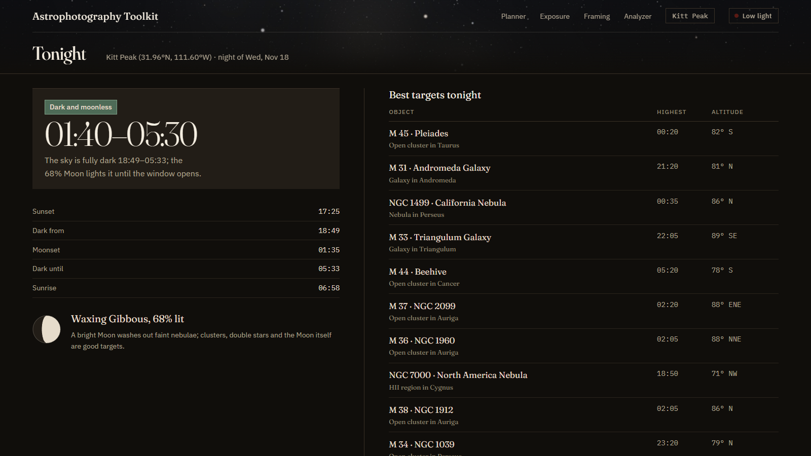
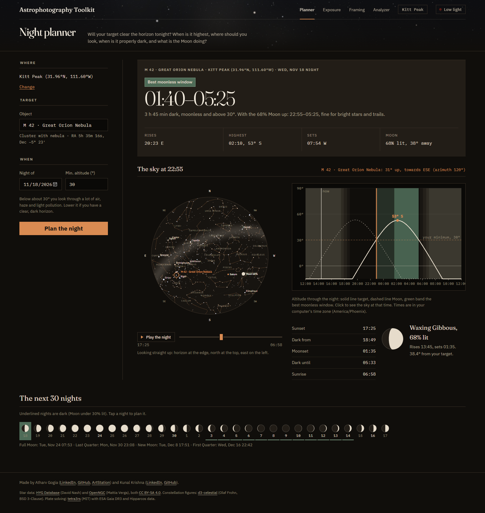
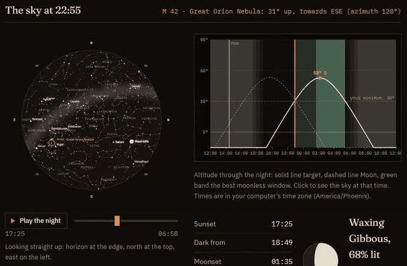
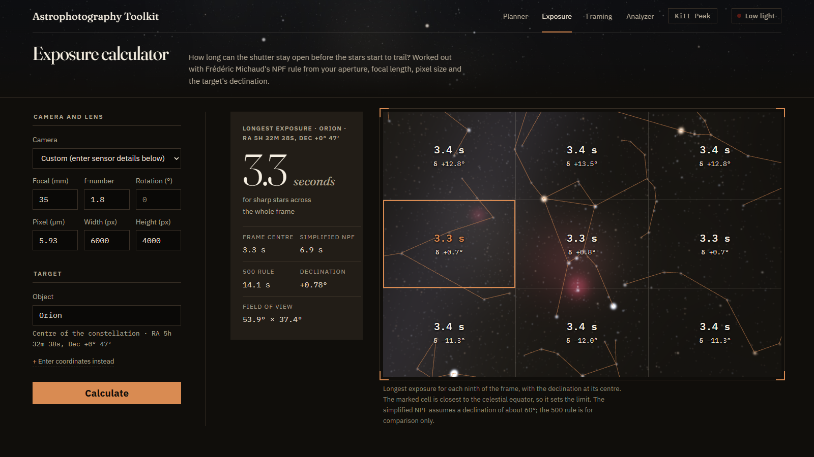
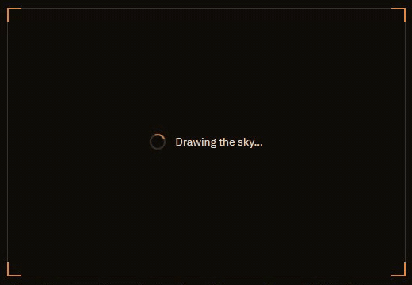
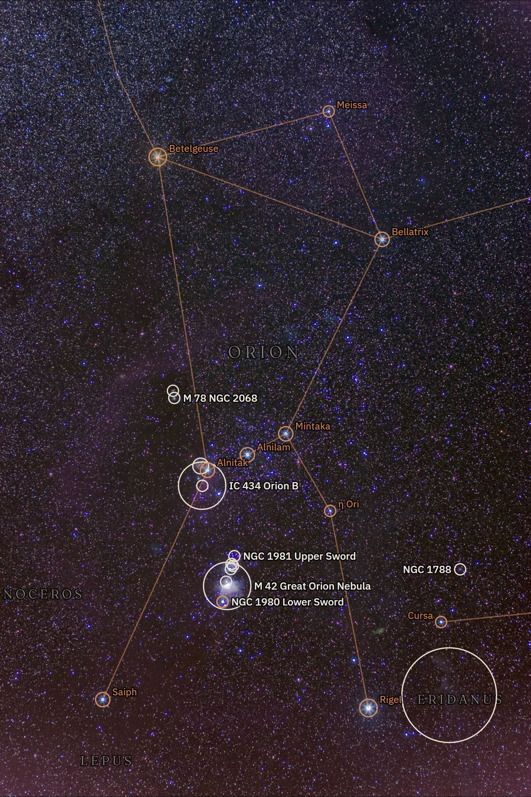

# Astrophotography Toolkit

A web app for night-sky photographers: plan the night, work out your exposure, check your framing,
and find out what is in a photo you took. Everything is computed from real star and deep-sky
catalogs, on your own computer or on the toolkit's server. There is no account and nothing to sign
up for.

**Try it: <https://astro.atharvgogia.in>** (the first visit after a quiet spell takes a few seconds
while the server starts), or [run it on your computer](#running-it-on-your-computer).



## What it does

### Tonight
The home page answers "is tonight worth going out?" for your location: the best moonless window,
twilight and Moon times, the Moon's phase, and the showpiece objects best placed tonight.

### Planner
Pick a target and a night. The planner tells you whether it clears your minimum altitude, when it
rises, peaks and sets, which way to look, and the best dark window, taking the Moon into account.
It shows an altitude chart for the whole night, a 30-night Moon calendar (click a night to plan it),
and an all-sky chart of the sky at any moment. Press **Play the night** to watch the sky turn from
sunset to sunrise.





### Exposure
The longest shutter time before stars trail, from Frédéric Michaud's NPF rule (the full formula,
not the simplified one). A 3 × 3 map shows how the limit changes across your sensor, drawn over the
sky your camera will actually see, with constellation figures.



### Framing
Your camera frame outlined on the real sky around a target, with field of view, pixel scale and
rotation. The frame turns and settles into place, the way the camera would.



### Analyzer
Open a photo to find exactly where it points and what is in it. It is plate-solved on the server or
your computer (no astrometry.net, no internet needed when run locally), then annotated with
constellation figures, named stars, nebulae, clusters and galaxies, and an optional RA/Dec grid.
Labels are limited to the starry part of the frame; trees, hills and buildings are detected and
their overlays hidden, with an **Over foreground** toggle to show them.

<p align="center"></p>

<sub>Solved in 3.1 s to 1.2 px accuracy (16.8° × 25.0° field). Photo: "Orion 3008 huge" by
<a href="https://commons.wikimedia.org/wiki/File:Orion_3008_huge.jpg">Mouser</a>, Wikimedia Commons,
<a href="https://creativecommons.org/licenses/by-sa/3.0/">CC BY-SA 3.0</a>; the annotated version
above is shared under the same licence.</sub>

### Around the app
- **Location**: set once from the header (your browser's location, or typed coordinates) and stored
  only in your browser. Times show in your computer's time zone.
- **Target search**: names autocomplete from the built-in catalogs and work offline; other names
  fall back to an online lookup (CDS Sesame).
- **Low-light mode**: a dim, red-only interface that keeps your eyes dark-adapted in the field.
  Every page works in it.
- **Phones**: every page works on a phone, for checking things beside the camera.
- **Motion**: answers arrive with short, purposeful animations. When your system asks for reduced
  motion, they become simple fades or are skipped.

## Running it on your computer

Needs Python 3.10 or newer.

```bash
pip install -r requirements.txt
python -m app
```

Then open <http://127.0.0.1:5000>. (`python backend.py` also still works.)

The first start builds the plate-solving index (a few seconds, about 30 MB in
`app/solver/cache/`); later starts just load it.

### Optional

- **RAW files.** `pip install rawpy` adds CR2/NEF/ARW/… support to the Analyzer.
- **Skymap image.** Sky previews are drawn from the built-in star catalog, with a modelled Milky
  Way. If you put a `composite_skymap_16k.png` (an all-sky plate carrée image, RA 0h at the centre)
  in the project folder, or point `SKYMAP_PATH` at one, it is used instead. The original one is in
  this [Google Drive folder](https://drive.google.com/drive/folders/1rrDNBE-_NzLOH3oTllvlRFs0W_YL9cPu?usp=sharing).
- `FLASK_DEBUG=1` runs the server in debug mode (off by default).

## Putting it online

The `Dockerfile` builds a container that runs anywhere Docker does. It is set up for
[Google Cloud Run](https://cloud.google.com/run), which scales to zero when nobody is using it, so
a hobby site usually costs nothing. Step-by-step instructions are in
[docs/DEPLOY_CLOUD_RUN.md](docs/DEPLOY_CLOUD_RUN.md). The public copy runs at <https://astro.atharvgogia.in>, behind a
Cloudflare Worker (`deploy/cloudflare-worker/`) that also shows a short "starting up" page while
Cloud Run wakes from idle.

The container sets these for public hosting (all optional when running locally):

| Variable | Effect |
| --- | --- |
| `HOSTED=1` | Privacy wording for a public site; uploads are processed in memory and discarded. |
| `SYNC_JOBS=1` | Solve photos inside the upload request (Cloud Run only gives CPU during requests). |
| `WARMUP_SYNC=1` | Load catalogs, solver index and sky map before serving. |
| `MAX_UPLOAD_MB` | Largest upload accepted (default 300; Cloud Run caps requests at 32 MiB). |
| `ANALYZE_PER_10_MIN` | Photo analyses allowed per visitor per 10 minutes (0 = no limit). |

## Plate solver: what to expect

- **Fields of view from about 10° to 90°**: camera lenses from roughly 15 mm to 135 mm on full
  frame. Typical solve time is 1–3 s. Telescope fields under 10° need a much larger star index
  (over 1 GB), so they aren't supported yet.
- **Accuracy:** sub-pixel on clean frames, and 1–3 px on typical processed photos. Very wide or
  strongly distorted lenses are looser (about 10 px on a 6000 px, 68° frame), which still puts
  labels in the right place. The lens-distortion fit steps down to a simpler model when a
  higher-order one would warp the edges.
- If you enter your camera and focal length, the solver tries that field of view first.

## Project layout

```
app/                Flask app (python -m app)
  routes/           pages, calculator and planner API, analyzer API
  catalogs/         star and deep-sky catalogs, name search
  solver/           plate solver: star detection (sep), pattern matching (tetra3rs),
                    lens-distortion fit (TAN-SIP)
  annotate.py       labels for a solved photo, and the sky/foreground mask
  planner.py        twilight, rise/transit/set, moonless windows, Moon phase and cycle (astropy)
  skychart.py       data for the all-sky chart: stars, figures, Milky Way, planets, Moon
  skymap.py         sky previews (reprojection to your camera's view)
  starfield.py      draws real star fields and the Milky Way from the catalog
  imageio.py        loads JPG/PNG/TIFF, FITS and RAW photos
  ratelimit.py      per-visitor limit for hosted analyses
  templates/        HTML pages
static/             CSS, JavaScript (one file per page, plus skychart.js), camera presets
scripts/            build_catalogs.py, render_masthead.py, prebuild.py (used by the Dockerfile)
docs/               deployment guide, README images
tests/              pytest suite: pip install -r requirements-dev.txt, then pytest
PRODUCT.md          who the toolkit is for and the principles behind its design
```

## Catalog data

Star data comes from the [HYG Database](https://github.com/astronexus/HYG-Database) by David Nash,
and deep-sky data from [OpenNGC](https://github.com/mattiaverga/OpenNGC) by Mattia Verga, both
CC BY-SA 4.0. Constellation figures are from [d3-celestial](https://github.com/ofrohn/d3-celestial)
by Olaf Frohn (BSD 3-Clause). See `app/catalogs/data/ATTRIBUTION.md`. To rebuild the trimmed copies,
download the originals into `catalog_raw/hyg/` and `catalog_raw/openngc/`, then run
`python scripts/build_catalogs.py`.

Plate solving uses [tetra3rs](https://github.com/ssmichael1/tetra3rs) (MIT) and its bundled star
catalog from ESA's Gaia DR3 mission, with Hipparcos for the brightest stars. Star detection uses
[sep](https://github.com/kbarbary/sep), the library version of Source Extractor.

Made by Atharv Gogia & Kunal Krishna.
